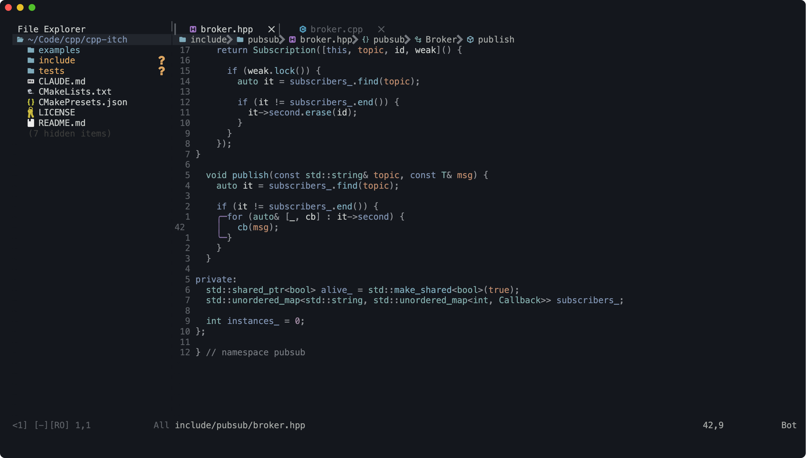

# dotfiles



macOS setup: Neovim, Ghostty, tmux, zsh + Powerlevel10k, AeroSpace, fastfetch.

```sh
git clone https://github.com/nagahole/dotfiles ~/dotfiles
cd ~/dotfiles
brew bundle          # install packages from Brewfile
stow .               # symlink everything into ~
```

tmux plugins: `git clone https://github.com/tmux-plugins/tpm ~/.tmux/plugins/tpm`, then `prefix + I`.
